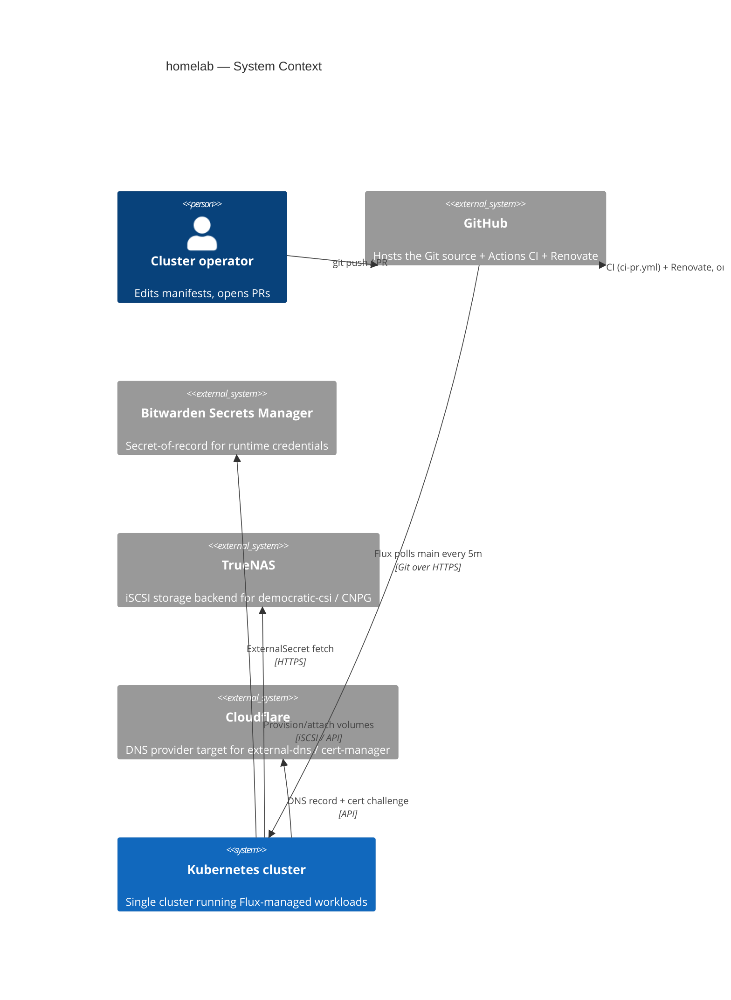
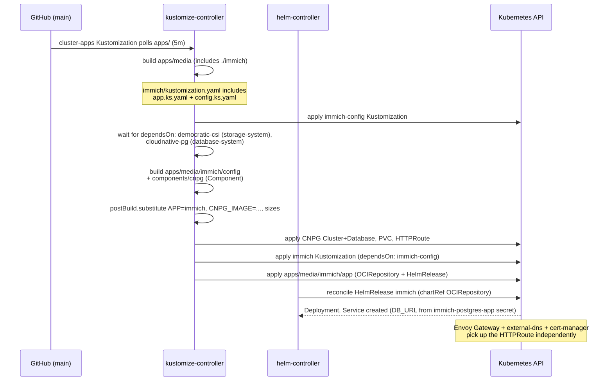
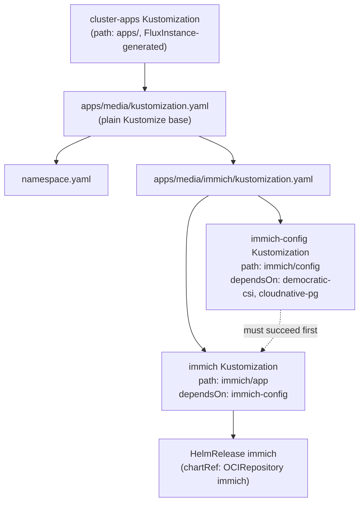
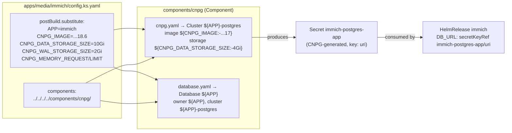
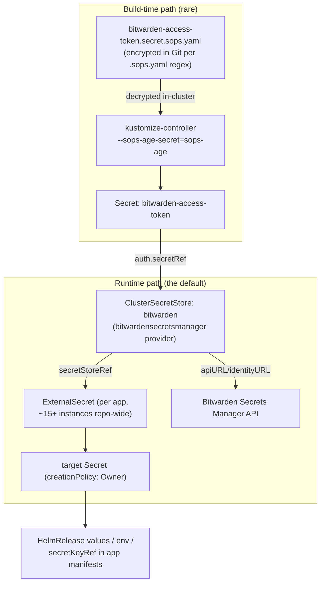

# homelab — Architecture Document

> Generated by the `doc-and-modernize` skill (Documentation mode). This document
> describes the exact state of the repository at the commit below, read from the
> local checkout. It is not application source code — it is declarative
> Kubernetes/Flux GitOps configuration, and this document is written for that
> reality.

## Checkout identity

| Field | Value |
|---|---|
| Remote | `git@github.com:William-Ro/homelab.git` (SSH, no embedded credentials) |
| Branch | `main` |
| HEAD commit | `9e6e5c62d2537f82aa0c6d76f5b32bc3af43af72` |
| HEAD subject | `fix(container): update ghcr.io/coredns/charts/coredns ( 1.48.2 → 1.49.0 )` |
| Commit count | 738 (`git log --oneline \| wc -l`) |
| First commit | `2026-03-17` — `docs: update README` / `chore: test helmfile` / `feat(longhorn): add values` |
| License | None found in repo root `[UNVERIFIED]` |

---

## Part 1 — Whole-repo technical deep-dive

### What the repository is

> "Declarative Kubernetes infrastructure and service configuration managed from
> a single Git source. This repository contains platform resources,
> infrastructure components, and self-hosted services organized into reusable
> and modular configurations for cluster operations, networking, storage,
> security, and applications." — [`README.md`](README.md)

Concretely: this is a **Flux CD GitOps repository** for a single Kubernetes
cluster. There is no application source code, build step, or runtime to deploy
from this repo itself — everything under `apps/` is a declarative manifest tree
that the in-cluster Flux controllers continuously reconcile against the live
cluster. "Correctness" here means "the manifests are valid, lint-clean, and
produce the Kustomize/Helm output Flux expects" — there is no compiled artifact.

### Tech-stack detection table

| Layer | Technology | Evidence |
|---|---|---|
| GitOps engine | Flux CD (`kustomize-controller`, `helm-controller`, `source-controller`, `notification-controller`) via the **Flux Operator** + **FluxInstance** CRD | [`apps/flux-system/flux-instance/app/helm-release.yaml#L12-L21`](apps/flux-system/flux-instance/app/helm-release.yaml) |
| Bootstrap installer | `helmfile` | [`bootstrap/helmfile.yaml`](bootstrap/helmfile.yaml) |
| Manifest composition | Kustomize (bases + a shared `Component` type) | [`components/cnpg/kustomization.yaml`](components/cnpg/kustomization.yaml), every `*/kustomization.yaml` |
| Package delivery | Helm charts, fetched as **OCI artifacts** (`OCIRepository`) or occasionally classic **Helm repos** (`HelmRepository`) | [`apps/media/immich/app/oci-repository.yaml`](apps/media/immich/app/oci-repository.yaml), [`apps/storage-system/democratic-csi/app/helm-repository.yaml`](apps/storage-system/democratic-csi/app/helm-repository.yaml) |
| Secrets encryption at rest | SOPS + age, decrypted by `kustomize-controller` in-cluster | [`.sops.yaml`](.sops.yaml), `--sops-age-secret=sops-age` in [`apps/flux-system/flux-instance/app/helm-release.yaml#L130-L134`](apps/flux-system/flux-instance/app/helm-release.yaml) |
| Runtime secret fetch | External Secrets Operator + Bitwarden Secrets Manager provider | [`apps/security-system/bitwarden-sdk-server/config/clustersecretstore.yaml`](apps/security-system/bitwarden-sdk-server/config/clustersecretstore.yaml) |
| DNS (cluster + internal) | CoreDNS (bootstrap-pinned) + Pi-hole + Unbound | [`bootstrap/helmfile.yaml#L8-L13`](bootstrap/helmfile.yaml), `apps/network-system/pihole`, `apps/network-system/unbound` |
| Load balancing | MetalLB (L2 advertisement, IP pool) | `apps/network-system/metallb/config/ip-pool.yaml`, `l2-advertisement.yaml` |
| Ingress / routing | Envoy Gateway + Kubernetes Gateway API (`Gateway`, `HTTPRoute`, `BackendTrafficPolicy`, `ClientTrafficPolicy`) | `apps/network-system/envoy-gateway/config/**` |
| External DNS | `external-dns` syncing records from `HTTPRoute`s | `apps/network-system/external-dns` |
| TLS issuance | cert-manager | `apps/network-system/cert-manager` |
| VPN / zero-trust remote access | Twingate | `apps/network-system/twingate` |
| Database | CloudNativePG (Postgres operator), shared via a Kustomize `Component` | [`components/cnpg/cnpg.yaml`](components/cnpg/cnpg.yaml), [`apps/database-system/cloudnative-pg`](apps/database-system/cloudnative-pg) |
| Storage/CSI | `democratic-csi` (TrueNAS iSCSI backend, `truenas-iscsi` StorageClass) | `apps/storage-system/democratic-csi`, `components/cnpg/cnpg.yaml#L16,20` |
| Observability | Grafana (+ Grafana Operator CRDs), Mimir, Alertmanager, Alloy, `kube-state-metrics`, `blackbox-exporter`, Prometheus Operator CRDs | `apps/observability-system/**`, [`bootstrap/crds/helmfile.yaml`](bootstrap/crds/helmfile.yaml) |
| In-cluster AI/MCP tooling | `flux-mcp` and `grafana-mcp` HelmReleases exposing MCP servers over HTTPRoute | `apps/flux-system/flux-mcp`, `apps/observability-system/grafana-mcp` |
| Media stack | Jellyfin, Sonarr/Radarr/Lidarr/Prowlarr/Bazarr/Recyclarr, SABnzbd, slskd, Navidrome, Seerr, Beets, Immich | `apps/media/*` (13 apps) |
| Node-system add-ons | kube-vip, descheduler, Reloader, Intel GPU device plugin + operator | `apps/kube-system/*` |
| Dependency automation | Renovate (shared org config + local overrides), scheduled hourly via a reusable workflow | [`.renovaterc.json`](.renovaterc.json), [`.github/workflows/renovate.yaml`](.github/workflows/renovate.yaml) |
| CI | GitHub Actions (`ci-pr.yml`): yamllint, gitleaks, Trivy config scan, `flux-local test`, `flux-local diff` | [`.github/workflows/ci-pr.yml`](.github/workflows/ci-pr.yml) |

### Entry points

There is no application process to "start." The operative entry points are:

1. **Cluster bootstrap** — `bootstrap/helmfile.yaml` installs CoreDNS →
   Flux Operator → FluxInstance, in that dependency order (`needs:`), onto a
   bare cluster. `bootstrap/crds/helmfile.yaml` is a separate, explicitly
   non-`sync` helmfile used only to extract and `kubectl apply --server-side`
   the CRDs of envoy-gateway, grafana-operator, and prometheus-operator-crds
   ([comment at top of file](bootstrap/crds/helmfile.yaml#L1-L6)) — these CRDs
   must exist before the corresponding `HelmRelease`s in `apps/` can reconcile.
2. **GitOps sync root** — once FluxInstance is installed, it creates a root
   `Kustomization` (`cluster-apps`) pointed at `path: apps/` on `refs/heads/main`
   with a 5-minute poll interval
   ([`apps/flux-system/flux-instance/app/helm-release.yaml#L32-L37`](apps/flux-system/flux-instance/app/helm-release.yaml)).
   This is the live entry point for every subsequent manifest in the repo.
   `.github/flux-local/kustomizations.yaml` is a **CI-only stand-in** for that
   same root Kustomization, used so `flux-local test` has something to build
   from without a live FluxInstance — it is explicitly marked "NOT deployed."

### Commands & Verification Inventory

| Command | Purpose | Evidence |
|---|---|---|
| `yamllint --strict -c .yamllint.yaml apps/ bootstrap/` | Strict YAML lint across the whole manifest tree | [`.github/workflows/ci-pr.yml` `syntax` job](.github/workflows/ci-pr.yml#L26-L40), [`.github/copilot-instructions.md`](.github/copilot-instructions.md) |
| `yamllint --strict -c .yamllint.yaml <single file>` | Focused lint of one file | [`.github/copilot-instructions.md`](.github/copilot-instructions.md) |
| `docker run ghcr.io/allenporter/flux-local:v8.4.0 test --all-namespaces --path .github/flux-local --skip-secrets --kustomize-build-flags=--load-restrictor=LoadRestrictionsNone -v` | Builds and validates the assembled Flux tree (Kustomizations + HelmReleases) end to end | [`.github/workflows/ci-pr.yml` `validate` job](.github/workflows/ci-pr.yml#L69-L89) |
| `kustomize build apps/media/immich/config` | Render a single Kustomize base directly (no Flux `dependsOn`/substitutions applied) | [`.github/copilot-instructions.md`](.github/copilot-instructions.md) |
| `flux-local diff helmrelease\|kustomization` (matrix) | Posts a diff of rendered HelmReleases/Kustomizations between PR head and default branch to the job summary | [`.github/workflows/ci-pr.yml` `diff` job](.github/workflows/ci-pr.yml#L91-L140) |
| `gitleaks` (GitHub Action) | Secret-leak scan; `continue-on-error: true` | [`.github/workflows/ci-pr.yml` `security` job](.github/workflows/ci-pr.yml#L42-L67) |
| `trivy config` scan | IaC misconfiguration scan, severities CRITICAL/HIGH; `exit-code: 0` (non-blocking) | same job |
| Renovate (scheduled, hourly cron + manual dispatch) | Dependency/chart/container/Flux-manifest version bumps via a reusable org workflow | [`.github/workflows/renovate.yaml`](.github/workflows/renovate.yaml) |

**CI trigger surface:** `ci-pr.yml` runs on `pull_request` targeting `main` and
on `push` to `renovate/**` branches, scoped to `apps/**`, `bootstrap/**`,
`.github/flux-local/**`, `.github/workflows/**` path changes
([`.github/workflows/ci-pr.yml#L5-L16`](.github/workflows/ci-pr.yml)).

**Enforcement status `[UNVERIFIED]`:** the `summary` job fails its own step if
`syntax` or `validate` didn't succeed, and posts a "Ready to Merge" comment, but
whether `syntax`/`validate`/`summary` are configured as **required status
checks** in GitHub branch protection (the setting that actually blocks merging)
cannot be determined from the local checkout — this is a human-configured,
platform-side setting. Treat CI today as "runs and reports" rather than
confirmed "blocks merge" unless a repo admin confirms branch protection rules.

### Directory layout

| Path | Purpose |
|---|---|
| `apps/` | Flux-synced root. One subdirectory per platform area (namespace group); everything here is live cluster state. |
| `apps/<area>/kustomization.yaml` | Assembles `namespace.yaml` + each child app directory into one Kustomize base for the area. |
| `apps/<area>/namespace.yaml` | The `Namespace` object for the area. |
| `apps/<area>/<app>/app/` | Chart installation: `OCIRepository`/`HelmRepository` + `HelmRelease` + its own `kustomization.yaml`. |
| `apps/<area>/<app>/config/` | Supporting resources (ExternalSecrets, HTTPRoutes, PVCs, CNPG clusters, dashboards) + its own `kustomization.yaml`. Present for 32 of 40 apps; omitted for apps with no supporting resources beyond the chart itself (e.g. `coredns`, `kube-vip`, `beets`). |
| `apps/<area>/<app>/app.ks.yaml` | Flux `Kustomization` pointing at `<app>/app`, usually `dependsOn: [<app>-config]`. |
| `apps/<area>/<app>/config.ks.yaml` | Flux `Kustomization` pointing at `<app>/config`, carrying `dependsOn`, `targetNamespace`, `postBuild.substitute`, and optional `components:`. |
| `apps/<area>/<app>/kustomization.yaml` | Includes both `*.ks.yaml` Flux Kustomizations into the area's base. |
| `bootstrap/` | `helmfile`-driven, one-time cluster bootstrap (CoreDNS, Flux Operator, FluxInstance) plus a separate CRD-extraction helmfile. |
| `components/cnpg/` | A reusable Kustomize `Component` (CloudNativePG `Cluster` + `Database`) parameterized via `postBuild.substitute` variables, consumed by any app needing its own Postgres instance. |
| `.github/flux-local/` | CI-only mirror of the FluxInstance-generated root Kustomization; not deployed. |
| `.github/workflows/` | `ci-pr.yml` (lint/security/validate/diff/summary) and `renovate.yaml` (scheduled dependency bot). |
| `.github/instructions/` | `applyTo`-scoped Copilot instruction file for manifest conventions. |
| `.renovate/` | Renovate grouping (`groups.json5`) and manager (`managers.json5`) overrides layered on a shared org config. |
| `docs/` | **Out of scope** — gitignored local clones of two other engineers' unrelated home-ops repos (`mirceanton/home-ops`, `chr1sd/home-ops`), kept as reference material only; not tracked by this repo's Git history (confirmed via `.gitignore` and `git ls-files docs/` returning nothing). |

### Deployment & Runtime Surface

| Component | Version pin | Evidence |
|---|---|---|
| CoreDNS | `1.49.0` | [`bootstrap/helmfile.yaml#L10`](bootstrap/helmfile.yaml) |
| Flux Operator / FluxInstance chart | `0.61.0` | [`bootstrap/helmfile.yaml#L15,21`](bootstrap/helmfile.yaml) |
| Flux distribution artifact (operator-managed controllers) | `v0.46.0` | [`apps/flux-system/flux-instance/app/helm-release.yaml#L21`](apps/flux-system/flux-instance/app/helm-release.yaml) |
| `kustomize-controller` image override | `ghcr.io/fluxcd/kustomize-controller:rc-203b42e7` (pinned to an RC build, not a stable release, for global `sops-age-secret` support) | [`apps/flux-system/flux-instance/app/helm-release.yaml#L148-L152`](apps/flux-system/flux-instance/app/helm-release.yaml) |
| CloudNativePG Postgres image (default) | `ghcr.io/cloudnative-pg/postgresql:17` | [`components/cnpg/cnpg.yaml#L8`](components/cnpg/cnpg.yaml) |
| CloudNativePG Postgres image (Immich override) | `ghcr.io/cloudnative-pg/postgresql:18.6-system-bookworm` | [`apps/media/immich/config.ks.yaml#L25`](apps/media/immich/config.ks.yaml) — **a per-app major-version drift from the component default (17 vs 18), by design via `postBuild.substitute`.** |
| CI runner image | `ubuntu-latest` (GitHub-hosted) | [`.github/workflows/ci-pr.yml`](.github/workflows/ci-pr.yml) throughout |
| `flux-local` validation image | `ghcr.io/allenporter/flux-local:v8.4.0` | same file, `validate`/`diff` jobs |
| envoy-gateway CRD chart | `v1.9.2` | [`bootstrap/crds/helmfile.yaml#L17`](bootstrap/crds/helmfile.yaml) |
| grafana-operator CRD chart | `5.25.0` | same file |
| prometheus-operator-crds chart | `32.0.1` | same file |
| Target Kubernetes version | `v1.36` (per badge) `[UNVERIFIED]` | [`docs/mirceanton/home-ops/README.md`](docs/mirceanton/home-ops/README.md) is a *different, unrelated repo* — no Kubernetes version badge or pin was found for **this** repo; node OS/CNI are provisioned outside this Git tree. |

There is no application container build (no `Dockerfile` in the repo) — every
workload is an upstream chart/image reference, so "build-runtime vs.
run-runtime drift" (a common hazard in app repos) does not apply here in the
usual sense. The nearest analog is the `kustomize-controller` RC-pin above,
which is a deliberate, documented tracking of an unreleased Flux feature.

### EOL / dead-dependency scan

- No frameworks or runtimes in this repo are themselves EOL — every pinned
  version (CoreDNS 1.49.0, Flux 0.61.0/v0.46.0, CNPG, envoy-gateway 1.9.2) is a
  current upstream release as of the HEAD commit, and Renovate is actively
  bumping them (the HEAD commit itself is a Renovate-style CoreDNS bump).
  `[INFERRED]` from commit history and `.renovaterc.json`.
- The one non-stable pin is the `kustomize-controller:rc-203b42e7` image
  override noted above — an intentional, commented trade-off (global
  `sops-age-secret` support) rather than neglect, but it is a release-candidate
  build that should be replaced once the feature lands in a stable Flux release.
- `bootstrap/crds/helmfile.yaml` is explicitly a workaround/manual step (its own
  header comment says it is "not intended to be used with `helmfile apply`") —
  operationally fragile by design, since it requires a human to re-run the
  `helmfile template | yq | kubectl apply` pipeline whenever those CRD charts
  change, rather than Flux reconciling them. `[INFERRED]` risk, not a defect.

### Data/storage, APIs, background jobs, CI/CD

- **Data/storage:** CloudNativePG provides per-app Postgres instances (Immich,
  implicitly others use the shared `components/cnpg` component); `democratic-csi`
  provisions iSCSI-backed PVCs against a TrueNAS backend (`truenas-iscsi`
  StorageClass default in [`components/cnpg/cnpg.yaml#L16,20`](components/cnpg/cnpg.yaml)).
  Mimir (object-store-backed metrics) uses S3-compatible credentials from
  "Garage" per the `mimir-s3-credentials` ExternalSecret.
- **APIs:** none authored in this repo — every workload's API surface is
  whatever the upstream Helm chart ships. The repo's own "API" is the Kubernetes
  API objects it declares (Flux CRDs, Gateway API, External Secrets CRDs, CNPG
  CRDs).
- **Plugins/extensions:** Kustomize `components/` is the repo's own extension
  mechanism — currently one component (`cnpg`) shared across apps that need a
  dedicated Postgres database.
- **Background jobs:** none authored directly; `descheduler` and `reloader` are
  cluster-level controllers that act like background jobs (descheduler
  rebalances pods, Reloader restarts workloads on ConfigMap/Secret change —
  used explicitly via the `reloader.stakater.com/auto: "true"` annotation on
  Immich's server deployment,
  [`apps/media/immich/app/helm-release.yaml#L25`](apps/media/immich/app/helm-release.yaml)).
- **CI/CD:** see Commands & Verification Inventory above; there is no deploy
  step in CI — deployment is pull-based (Flux polling Git), so "CD" here means
  "Flux reconciling `main`," not a pipeline job.
- **Testing:** no unit/integration test suite exists or is applicable; the
  closest analog is `flux-local test` (structural/build validation of the
  manifest tree) and the PR-diff job (change visibility, not pass/fail
  correctness).

---

## Part 2 — Context & ecosystem

### Checkout identity

See the table at the top of this document.

### Repo-specific agent/contributor docs present

| File | Encodes |
|---|---|
| [`.github/copilot-instructions.md`](.github/copilot-instructions.md) | The app/config split, bootstrap/FluxInstance relationship, validation commands, and repo conventions (components, `dependsOn`, SOPS filenames, yamllint). Auto-loaded by GitHub Copilot. |
| [`.github/instructions/kubernetes-manifests.instructions.md`](.github/instructions/kubernetes-manifests.instructions.md) | The same conventions, scoped via `applyTo` to `apps/**/*.yaml`, `bootstrap/**/*.yaml`, `components/**/*.yaml`, `.github/flux-local/**/*.yaml` — i.e., it governs manifest edits specifically, separate from the general-repo file above. |
| [`README.md`](README.md) | One-paragraph repo description; minimal, no quick-start. |

No `CONTRIBUTING.md` or `CODEOWNERS` file was found in the repo root or
`.github/`. `[UNVERIFIED]` — not confirmed absent beyond a root/`.github` listing.

### Developer gotchas (each cited)

- **A plain `kustomize build` on one app base is not a full validation.** It
  skips Flux `dependsOn` ordering and `postBuild.substitute` variables (e.g.
  `${APP}`, `${CNPG_IMAGE}` in `components/cnpg/cnpg.yaml` are only ever
  resolved by the owning Flux Kustomization's `postBuild.substitute`, never by
  Kustomize itself) — the repo's own instructions call this out explicitly
  ([`.github/copilot-instructions.md`](.github/copilot-instructions.md)).
- **`bootstrap/crds/helmfile.yaml` must not be run with `helmfile apply`/`sync`**
  — it's a template-and-extract pipeline for CRDs only, per its own header
  comment. Running it the normal way would attempt a full chart install
  alongside CRD-only charts.
- **Secret filenames are a hard contract.** `.sops.yaml`'s `path_regex` only
  encrypts files matching `.*\.secret(\.sops)?\.yaml` — a secret manifest named
  anything else will not be encrypted by the configured rule, risking a
  plaintext secret commit. Only one file in the repo currently uses this path
  (`bitwarden-access-token.secret.sops.yaml`); most "secrets" in this repo are
  actually `ExternalSecret` objects (no sensitive data at rest in Git at all),
  making the SOPS path the exception rather than the norm.
- **CI is scoped by path filters**, not "every push/PR." A change confined to,
  say, `.renovate/` or `README.md` will not trigger `ci-pr.yml`
  ([`.github/workflows/ci-pr.yml#L5-L16`](.github/workflows/ci-pr.yml)).
- **Flux-local's CI root Kustomization is a hand-maintained stand-in** —
  `.github/flux-local/kustomizations.yaml` must be kept consistent with
  whatever FluxInstance actually generates at runtime (`path: apps/`), or CI
  could pass while the real cluster's root Kustomization has drifted
  conceptually (it won't desync on content, since both point at `apps/`, but it
  is a manually-synchronized duplicate rather than a single source of truth).

### Relationship to broader ecosystem (as visible from disk)

- Renovate configuration extends a shared org-wide base,
  `github>William-Ro/renovate-config//default.json5`
  ([`.renovaterc.json`](.renovaterc.json)), implying a sibling
  `William-Ro/renovate-config` repository that centralizes update policy across
  this user's repos.
- The scheduled Renovate workflow itself is not inlined — it calls a reusable
  workflow, `William-Ro/github-workflows/.github/workflows/renovate.yaml`
  ([`.github/workflows/renovate.yaml#L23`](.github/workflows/renovate.yaml)),
  another sibling repo providing shared CI/CD workflow definitions.
- `docs/mirceanton/home-ops` and `docs/chr1sd/home-ops` are gitignored local
  clones of **other people's** unrelated home-ops repositories, evidently kept
  as prior-art/reference material while building this one. They are not part
  of this project and are excluded from the rest of this document.

---

## Part 3 — Architectural blueprint

### Tech-stack summary

See the Part 1 detection table. In one line: **Flux CD (Operator + FluxInstance)
pulling from a single Git repo, rendering Kustomize bases that wire together
upstream Helm charts (via OCI/Helm repositories) with supporting Kubernetes
resources, secrets sourced from Bitwarden via External Secrets Operator, SOPS
for the rare committed secret, and Envoy Gateway/Gateway API for ingress.**

### C4 Level 1 — System context



### C4 Level 2 — Containers (in-cluster)

```mermaid
C4Container
    title homelab — In-cluster containers (by platform area)

    System_Boundary(flux_system, "flux-system") {
        Container(flux_op, "Flux Operator + FluxInstance", "controllers", "source/kustomize/helm/notification-controller")
        Container(flux_mcp, "flux-mcp", "HelmRelease", "MCP server over Flux")
    }
    System_Boundary(net, "network-system") {
        Container(envoy, "Envoy Gateway", "Gateway API impl.", "Admin + internal Gateways, HTTPRoutes")
        Container(metallb, "MetalLB", "L2 LB", "Assigns Gateway LoadBalancer IPs")
        Container(dns, "CoreDNS / Pi-hole / Unbound / external-dns", "DNS stack")
        Container(certmgr, "cert-manager", "TLS issuance")
        Container(twingate, "Twingate", "Zero-trust remote access")
    }
    System_Boundary(sec, "security-system") {
        Container(eso, "External Secrets Operator", "controller")
        Container(bw, "bitwarden-sdk-server", "HelmRelease", "Bitwarden SDK backend for ClusterSecretStore")
    }
    System_Boundary(db, "database-system") {
        Container(cnpg, "CloudNativePG operator", "Postgres clusters for apps")
    }
    System_Boundary(storage, "storage-system") {
        Container(dcsi, "democratic-csi", "CSI driver", "iSCSI to TrueNAS")
    }
    System_Boundary(obs, "observability-system") {
        Container(grafana, "Grafana + Grafana Operator")
        Container(mimir, "Mimir", "metrics store")
        Container(alertmgr, "Alertmanager")
        Container(alloy, "Alloy", "telemetry collector")
    }
    System_Boundary(media, "media (13 apps)") {
        Container(mediaapps, "Jellyfin / *arr stack / Immich / slskd / Navidrome / Seerr", "HelmReleases")
    }

    Rel(flux_op, net, "reconciles")
    Rel(flux_op, sec, "reconciles")
    Rel(flux_op, db, "reconciles")
    Rel(flux_op, storage, "reconciles")
    Rel(flux_op, obs, "reconciles")
    Rel(flux_op, media, "reconciles")
    Rel(media, cnpg, "DB via Secret ref (e.g. immich-postgres-app)")
    Rel(media, envoy, "HTTPRoute")
    Rel(media, eso, "ExternalSecret")
    Rel(envoy, metallb, "LoadBalancer Service")
    Rel(eso, bw, "ClusterSecretStore: bitwarden")
```

### C4 Level 3 — Representative lifecycle: an app's Flux reconciliation

This traces the Immich app
([`apps/media/immich/`](apps/media/immich/)) as the representative
request/component lifecycle, since it exercises every repo convention at once:
chart install, supporting config, a shared `Component`, `postBuild.substitute`,
cross-namespace `dependsOn`, and a Gateway API route.



### Layering and dependency rules

- **Area → app → (app|config) is a strict containment hierarchy enforced by
  `kustomization.yaml` includes**, not by any tooling-level rule — a developer
  could technically break it, but every existing app follows it
  (`.github/instructions/kubernetes-manifests.instructions.md` codifies it as
  policy for new changes).
- **Ordering between apps/namespaces is expressed only via Flux `dependsOn`**,
  never via Kustomize resource ordering — e.g.
  `apps/media/immich/config.ks.yaml` depends on `democratic-csi` (storage-system)
  and `cloudnative-pg` (database-system), both in different namespaces,
  demonstrating that `dependsOn` is namespace-qualified and cross-area by
  design.
- **`postBuild.substitute` lives only on the Flux Kustomization**, never
  injected into the Kustomize base itself — `components/cnpg/cnpg.yaml` uses
  `${APP}`/`${CNPG_IMAGE}` placeholders that are inert until a consuming
  `config.ks.yaml` supplies them, which is why a raw `kustomize build` on an app
  using this component will literally emit the `${VAR}` placeholders unresolved.
- **Bootstrap is lower-layered than Flux-managed `apps/`** — `bootstrap/`
  installs the very controllers (`flux-operator`, `flux-instance`) that later
  reconcile `apps/`, and explicitly reads chart values back out of
  `apps/<ns>/<name>/app/helm-release.yaml` via `values.yaml.gotmpl` so the two
  layers never hold two independent copies of the same values.

### Cross-cutting concerns table

| Concern | Location | Evidence |
|---|---|---|
| AuthN/Z (secrets access) | External Secrets Operator `ClusterSecretStore` → Bitwarden Secrets Manager, mTLS CA from `bitwarden-tls-certs` | `apps/security-system/bitwarden-sdk-server/config/clustersecretstore.yaml` |
| Config / values | Chart values live in each app's `HelmRelease.spec.values`; bootstrap reads the same source, never duplicated | [`.github/copilot-instructions.md`](.github/copilot-instructions.md), `bootstrap/templates/values.yaml.gotmpl` |
| Secrets at rest | SOPS + age; only `*.secret(.sops)?.yaml` files are encrypted, matched by regex | `.sops.yaml` |
| Logging/metrics/tracing | Alloy (collector) → Mimir (metrics) + Grafana (viz) + Alertmanager (alerting), `kube-state-metrics`/`blackbox-exporter` as metric sources, `GrafanaFolder` CRs grouping dashboards per area | `apps/observability-system/*`, `apps/*/grafana-folder.yaml` |
| Feature flags | None found `[UNVERIFIED]` |
| Error handling / health | Flux `wait: true` + `health checks` implicit in `kustomize.toolkit.fluxcd.io` Kustomizations (`wait: true` on every `*.ks.yaml`); `CancelHealthCheckOnNewRevision` feature gate enabled on kustomize-controller | `apps/flux-system/flux-instance/app/helm-release.yaml#L138-L143` |
| Dependency updates | Renovate, org-shared base + local `groups.json5`/`managers.json5`, scoped to flux/helm-values/kubernetes managers over all `.yaml` | `.renovaterc.json`, `.renovate/*.json5` |

### Inferred Architectural Decision Records

#### ADR: Split every app into `app/` (chart) and `config/` (supporting resources)
- **Context:** Charts need to be upgraded independently of hand-authored
  supporting resources (routes, secrets, DB clusters), and ordering between
  them (e.g. DB must exist before the app starts) needs to be explicit.
- **Decision:** Separate Kustomize bases per concern, wired by two Flux
  Kustomizations with a `dependsOn` from `app` → `config`.
- **Alternatives considered:** A single flat Kustomize base per app
  `[INFERRED]` — rejected because Flux `dependsOn` only operates at the
  Kustomization level, not within a single build.
- **Consequences:** More files per app (the template is verbose for simple
  charts, hence 8 apps with no `config/` at all), but ordering and partial
  updates (e.g. re-applying just `config/`) become possible.

#### ADR: Shared Postgres provisioning via a Kustomize `Component`
- **Context:** Several apps (at least Immich, cloudnative-pg's own dashboard)
  need a dedicated Postgres database; duplicating the `Cluster`/`Database`
  manifests per app would drift.
- **Decision:** One `components/cnpg` Component, parameterized entirely via
  `postBuild.substitute` variables set on the consuming `config.ks.yaml`.
- **Alternatives considered:** A single shared multi-tenant Postgres cluster
  `[INFERRED]` — rejected implicitly, since each app gets its own `Cluster`
  (`${APP}-postgres`), favoring isolation over resource sharing.
- **Consequences:** Per-app CNPG images can drift from the component default
  (see Immich's Postgres 18 vs. the component's default 17) — a deliberate
  override surface, but one that requires tracking per-app image versions
  outside Renovate's usual chart-version awareness unless the `kubernetes`
  manager picks up the plain image string.

#### ADR: Secrets sourced from Bitwarden at runtime, SOPS reserved for the exception
- **Context:** Committing encrypted secrets to Git (SOPS) works, but requires
  decryption keys to be distributed to the cluster and ties secret rotation to
  a Git commit.
- **Decision:** Default to `ExternalSecret` + Bitwarden Secrets Manager for
  almost every credential; SOPS is kept only for the one secret
  (`bitwarden-access-token`) that bootstraps access to Bitwarden itself — an
  unavoidable chicken-and-egg case.
- **Alternatives considered:** SOPS-for-everything `[INFERRED]` — rejected,
  evidenced by only one SOPS-encrypted file existing in the entire `apps/` tree
  versus ~15+ `ExternalSecret` resources.
- **Consequences:** Secret rotation for most credentials happens outside Git
  entirely (in Bitwarden), which is good for rotation but means Git history
  alone cannot reconstruct "what secret value was live at commit X."

### Governance & enforcement mechanisms

- **CI gates** (`ci-pr.yml`): yamllint (blocking per `summary` job's exit-1
  logic), `flux-local test` (blocking), gitleaks/Trivy (non-blocking,
  `continue-on-error`/`exit-code: 0`), diff reporting (informational).
  **Whether these are enforced as GitHub required status checks is
  `[UNVERIFIED]`** from the local checkout — see the Commands inventory note.
- **Schema validation at edit time**: nearly every manifest carries a
  `# yaml-language-server: $schema=...` comment pointing at
  `kubernetes-schemas.pages.dev` or `json.schemastore.org`, giving editor-time
  (not CI-time) validation — a convention, not an enforced gate.
- **No CODEOWNERS / branch protection file found in-repo** `[UNVERIFIED]` —
  these are typically GitHub-side settings not visible from the checkout.
- **Renovate as a governance mechanism**: an hourly scheduled workflow
  continuously proposes version bumps across Helm charts, container images,
  and Flux manifests, keeping the EOL/dead-dependency surface small by policy
  rather than by one-off manual upgrades.

### How to add a feature (i.e., a new app)

1. Create `apps/<area>/<new-app>/app/` with `oci-repository.yaml` (or
   `helm-repository.yaml`), `helm-release.yaml`, and a `kustomization.yaml`
   listing both.
2. If the app needs supporting resources (secrets, routes, PVCs, a dedicated
   DB), create `apps/<area>/<new-app>/config/` similarly, adding
   `components: [../../../../components/cnpg/]` if it needs its own Postgres.
3. Add `app.ks.yaml` (targetNamespace, `dependsOn: [<new-app>-config]` if
   `config/` exists) and `config.ks.yaml` (targetNamespace, `dependsOn` on any
   platform services it needs, `postBuild.substitute` for component variables).
4. Add `kustomization.yaml` at the app root including both `*.ks.yaml` files.
5. Add `./<new-app>` to `apps/<area>/kustomization.yaml`'s `resources:`.
6. Validate locally: `yamllint --strict -c .yamllint.yaml apps/<area>/<new-app>`
   and the full `flux-local test` before opening a PR.

**Common pitfalls:** forgetting to add the new app directory to the area's
`kustomization.yaml` (Flux will never see it); using `${VAR}` substitution
syntax inside a plain Kustomize base instead of on the Flux Kustomization
(silently emitted literally, not an error); naming a secret file without the
`.secret(.sops)?.yaml` suffix (SOPS won't encrypt it — verify with
`git diff` before committing, not just by running CI).

---

## Subsystem deep-dives

### 1. Flux reconciliation graph (`app.ks.yaml` / `config.ks.yaml` pattern)

This is the single most important mechanical pattern in the repo — nearly every
file in `apps/` exists to express one node and its edges in this graph.

**Structure:** two Flux `Kustomization` CRs per app (`app`, `config`), each
independently pollable (`interval: 10m` typically), each with its own
`dependsOn` list. The area-level `kustomization.yaml` is a plain Kustomize base
(not a Flux Kustomization) that simply bundles the Namespace and all child apps
into one buildable tree for the root `cluster-apps` Kustomization to apply.



**Key types:** `kustomize.toolkit.fluxcd.io/v1 Kustomization` (the orchestration
unit — `interval`, `prune`, `wait`, `targetNamespace`, `dependsOn`,
`postBuild.substitute`, optional `components:`),
`helm.toolkit.fluxcd.io/v2 HelmRelease` (`chartRef` to an `OCIRepository` or
classic `HelmRepository`+`chart` reference), `source.toolkit.fluxcd.io`
`OCIRepository`/`HelmRepository` (where the chart bytes come from).

**Data flow:** Git commit → root Kustomization poll (5m) → area base build →
per-app `config` Kustomization (resources + `Component` + substitutions) →
per-app `app` Kustomization (gated on `config` via `dependsOn`) →
`helm-controller` installs/upgrades the `HelmRelease`.

**Lifecycle nuance:** `dependsOn` is evaluated by `kustomize-controller` at the
**Kustomization** level, so cross-namespace dependencies
(`immich-config` → `cloudnative-pg` in `database-system`) work by referencing
`name` + `namespace` on the `dependsOn` entry
([`apps/media/immich/config.ks.yaml#L31-L34`](apps/media/immich/config.ks.yaml)).
This is the mechanism that makes "deploy order" a declarative graph rather than
directory/file ordering.

### 2. Shared Postgres provisioning via the `cnpg` Kustomize Component



**Internal structure:** the `Component` (`kustomization.config.k8s.io/v1alpha1
Component`, not a regular base — this `kind` is what lets multiple consumers
include the same resources without a parent/child Kustomize relationship) emits
two CRs whose fields are all `${VAR:-default}` placeholders. Every default is
baked into `components/cnpg/cnpg.yaml`/`database.yaml` themselves, so a consumer
that supplies **no** substitutions still gets a working (if minimally sized)
Postgres instance — only `${APP}` is mandatory in practice (it has no default
and appears in both the cluster name and the database/owner name).

**Key risk surface (noted, not a defect):** because `CNPG_IMAGE` has no
repo-wide enforcement across consumers, apps can silently diverge on major
Postgres versions (confirmed: Immich runs Postgres 18 against a component whose
own default is Postgres 17) — intentional per-app flexibility, but worth
tracking if a future upgrade needs all CNPG clusters on one major version
simultaneously.

### 3. Secrets: SOPS (build-time) vs. External Secrets (runtime)



**Why this split matters:** the bootstrap secret is the only credential that
must exist *before* the External Secrets control loop itself can authenticate
to Bitwarden — a one-time chicken-and-egg problem solved with SOPS, after which
every other secret in the repo flows through the ClusterSecretStore instead.
This is why `.sops.yaml`'s regex exists but is almost unused: the design
intentionally minimizes the blast radius of "a secret committed to Git,"
reserving it for the single unavoidable case.

---

## Confidence assessment

| Claim area | Confidence | Notes |
|---|---|---|
| Directory/app structural conventions (app/config split, `.ks.yaml` wiring) | **High** | Directly verified across many apps (Immich, external-dns, twingate, democratic-csi, cloudnative-pg) and matches the written repo instructions exactly. |
| Bootstrap sequencing (CoreDNS → Flux Operator → FluxInstance) | **High** | Explicit `needs:` chain read directly from `bootstrap/helmfile.yaml`. |
| CI gate list and trigger scope | **High** | Read directly from `.github/workflows/ci-pr.yml`. |
| CI *enforcement* (required status checks / branch protection) | **Unverified** | Not visible from the local checkout; platform-side GitHub setting. |
| Secrets model (SOPS exception + Bitwarden default) | **High** | Verified by counting SOPS-named files (1) vs. `ExternalSecret` resources (15+) across `apps/`. |
| CNPG per-app image divergence being intentional vs. accidental | **Inferred** | The mechanism clearly allows divergence; whether the Immich 17→18 gap is a deliberate upgrade-in-progress or an oversight isn't stated anywhere in-repo. |
| Target Kubernetes cluster version | **Unverified** | No version pin found for this repo; the only version badge found belongs to an unrelated reference repo under gitignored `docs/`. |
| License | **Unverified** | No `LICENSE` file found at the root. |
| Renovate/workflow sibling repos (`renovate-config`, `github-workflows`) existing and current | **Inferred** | Referenced by name/ref in config; not fetched or verified remotely, per the local-first/last-resort rule. |

---

## Footnotes — local file citations

- [`README.md`](README.md) — one-paragraph repo description.
- [`.github/copilot-instructions.md`](.github/copilot-instructions.md) — canonical repo conventions and validation commands.
- [`.github/instructions/kubernetes-manifests.instructions.md`](.github/instructions/kubernetes-manifests.instructions.md) — scoped manifest-editing rules (`applyTo` glob).
- [`.github/workflows/ci-pr.yml`](.github/workflows/ci-pr.yml) — full CI gate definition (syntax, security, validate, diff, summary jobs).
- [`.github/workflows/renovate.yaml`](.github/workflows/renovate.yaml) — scheduled dependency-update workflow, calls a reusable org workflow.
- [`.github/flux-local/kustomizations.yaml`](.github/flux-local/kustomizations.yaml) — CI-only stand-in for the FluxInstance-generated root Kustomization.
- [`bootstrap/helmfile.yaml`](bootstrap/helmfile.yaml) — bootstrap install order (CoreDNS → Flux Operator → FluxInstance).
- [`bootstrap/crds/helmfile.yaml`](bootstrap/crds/helmfile.yaml) — separate, manual-only CRD extraction helmfile.
- [`bootstrap/templates/values.yaml.gotmpl`](bootstrap/templates/values.yaml.gotmpl) — reads bootstrap chart values from the matching app `HelmRelease`.
- [`components/cnpg/`](components/cnpg/) — shared Kustomize `Component` for per-app Postgres (cluster + database).
- [`.sops.yaml`](.sops.yaml) — SOPS encryption rule for `*.secret(.sops)?.yaml` files.
- [`.yamllint.yaml`](.yamllint.yaml) — strict yamllint ruleset used by CI and local validation.
- [`.renovaterc.json`](.renovaterc.json), [`.renovate/groups.json5`](.renovate/groups.json5), [`.renovate/managers.json5`](.renovate/managers.json5) — dependency-update configuration.
- [`apps/flux-system/flux-instance/app/helm-release.yaml`](apps/flux-system/flux-instance/app/helm-release.yaml) — FluxInstance sync target (`main`, `apps/`, 5m) and controller patches (RC image, feature gates, SOPS flag).
- [`apps/media/immich/`](apps/media/immich/) — representative full-pattern app (app/config split, cnpg component, cross-namespace `dependsOn`, Gateway API route).
- [`apps/security-system/bitwarden-sdk-server/config/clustersecretstore.yaml`](apps/security-system/bitwarden-sdk-server/config/clustersecretstore.yaml) — the `ClusterSecretStore` all `ExternalSecret`s reference.
- [`apps/network-system/envoy-gateway/config/`](apps/network-system/envoy-gateway/config/) — Gateway API admin/internal gateway split, traffic policies.
- `.gitignore` (line: `docs`, `docs/mirceanton`) — confirms `docs/` reference clones are untracked and out of scope.
